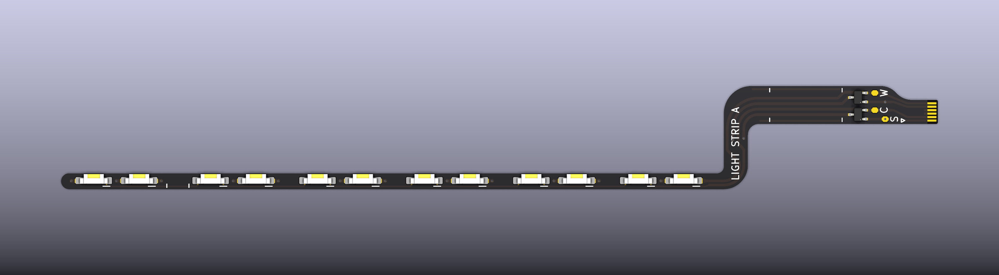
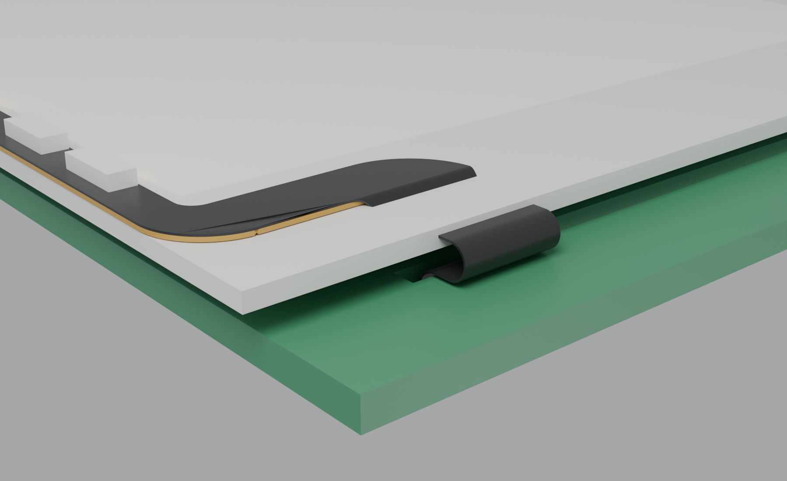
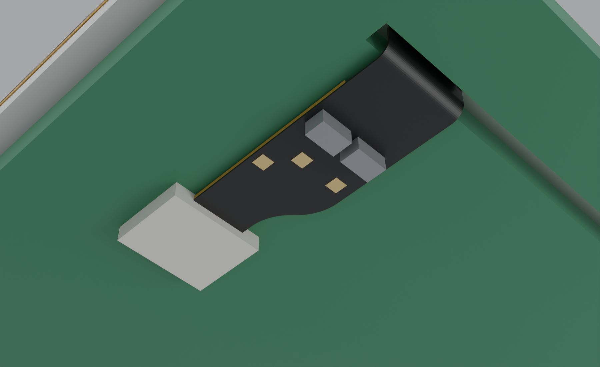
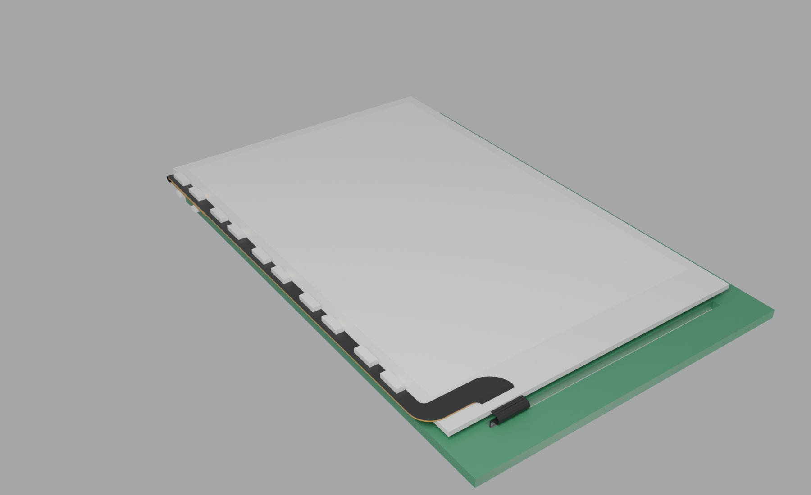
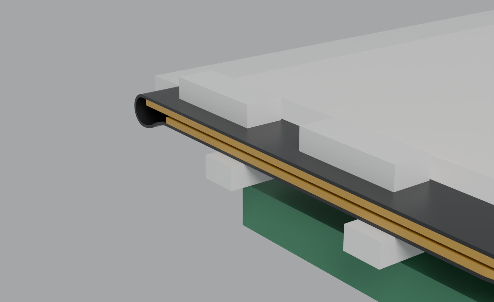
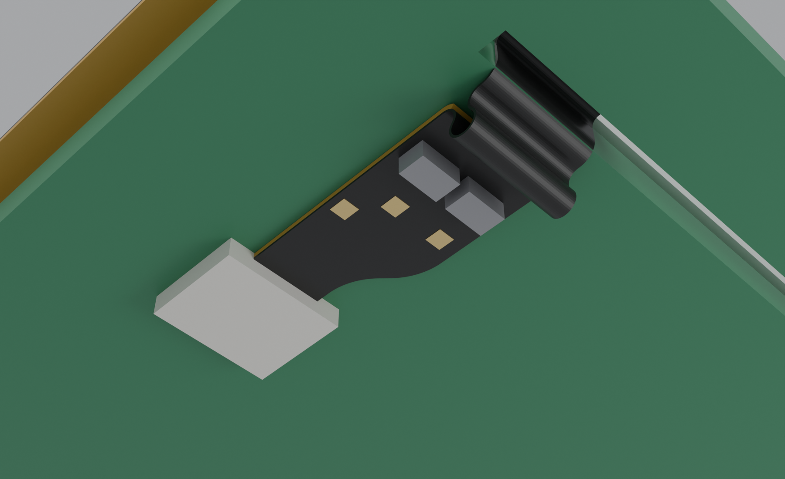
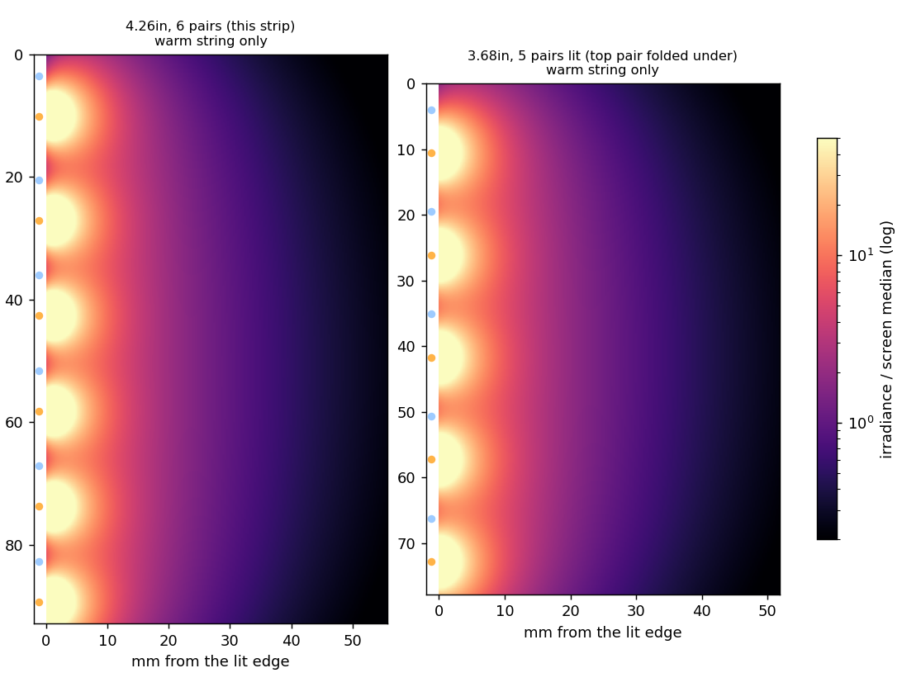
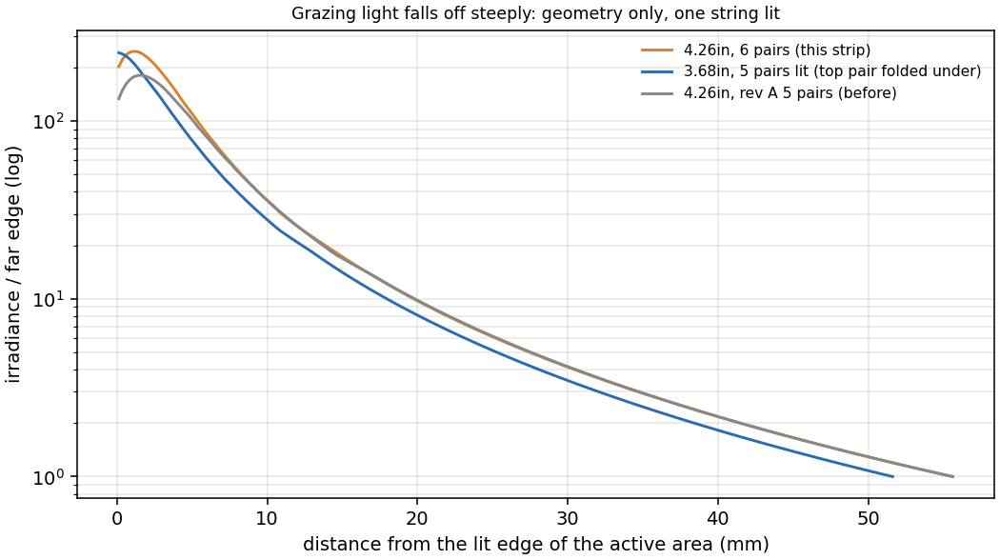
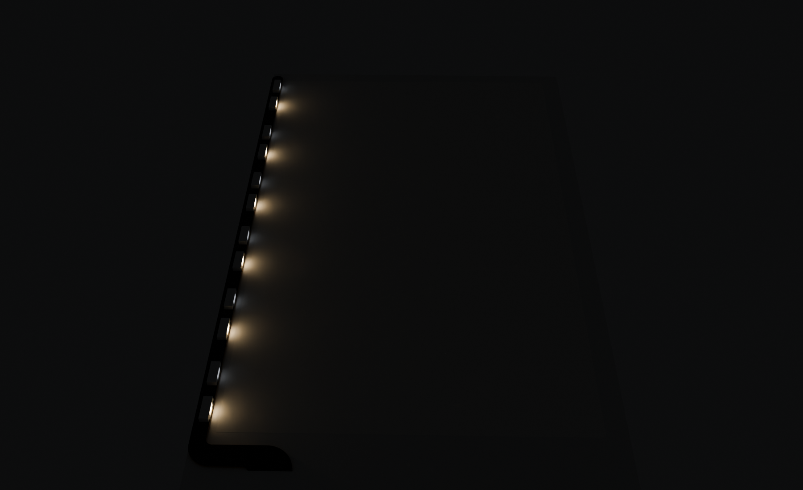

# Silkscreen light strip

> [!IMPORTANT]
> **AI-generated design. This is an accessory, not part of the Silkscreen PCBA.**
>
> This light strip was designed with substantial AI assistance: its KiCad project is generated by scripts written with
> AI tools. It serves two purposes: a test of what AI tools can and cannot do with a simple electrical design like an
> LED strip, and a functional accessory for the base Silkscreen PCBA. The Silkscreen PCBA itself
> ([silkscreen-pcb](https://github.com/iandchasse/silkscreen-pcb)) was not AI-generated.
>
> See Silkscreen's AI disclosure: https://silkscreenreader.com/ai

**A DIY warm/cool reading light for the [Silkscreen](https://github.com/iandchasse/silkscreen-pcb) e-reader.** It is a thin flex PCB that plugs into the main board's frontlight connector (labelled `J3` on the back of the board), in place of a panel's bonded frontlight. It runs six warm/cool pairs of side-emitting LEDs along the left edge of the e-paper panel, and the light grazes across the page with no light guide.

**One strip fits two readers:**

- the **4.26″** plain `GDEY0426T82`, where the LED bar lies on the panel's left border;
- the **3.68″** 528 × 792 panel of the x3 build, where the bar lies beside the glass and the top pair folds back under it.

**Not released.** The website does not offer the strip or its cases. This repo is the design, its fabrication files and its documents, for anyone who wants to build one.

**The cases** are in [silkscreen-enclosures](https://github.com/iandchasse/silkscreen-enclosures). Each reader's case project can also build a light-strip case, which the strip needs: the tub, and on the 3.68″ also the four bottom keys. Those cases are in development and not released either (see [The cases](#the-cases)).

**Where things are:**

| To | Go to |
|---|---|
| **Order the light strip (rev A, untested)** | [`production/`](production/) and [docs/ORDERING.md](docs/ORDERING.md) |
| **Assemble and fit the strip** | [docs/ASSEMBLY.md](docs/ASSEMBLY.md) |
| **Print a paste stencil** and its card squeegee, one plate (experimental, untested) | [`production/stencil/`](production/stencil/) (`stencil-kit_*.3mf`) and [docs/ASSEMBLY.md §2, option](docs/ASSEMBLY.md#option-3d-printed-paste-stencil-and-oven-reflow-experimental-untested) |
| **The cases** | the light-strip builds in [silkscreen-enclosures](https://github.com/iandchasse/silkscreen-enclosures) (`enclosures/case-426`, `enclosures/case-368`), in development with the strip |
| **Change the strip** | `tools/` (it generates the KiCad project at the root and everything in `docs/` and `production/`); the design is in [docs/DESIGN.md](docs/DESIGN.md) |
| **Read the documents** | the [documents index](#documents) below: design, ordering, assembly, reports, research and reviews |

> **Rev A is untested.** The strip passes ERC, DRC and schematic parity with no findings. Four review rounds have been worked through ([docs/DESIGN.md §8](docs/DESIGN.md#8-verification) lists them; the first round's reports are in [docs/review/](docs/review/)). No board has been built yet. Before you solder a whole strip, diode-test one loose LED ([docs/ASSEMBLY.md](docs/ASSEMBLY.md#1-check-led-polarity-before-anything-else)).

| Flat, LED side (turned 90°) |
|:---:|
|  |

| 4.26″: on the border, around the glass edge | 4.26″: behind the board, into the frontlight connector |
|:---:|:---:|
|  |  |

| 3.68″: beside the panel | 3.68″: top pair folded back under the bar | 3.68″: spare tail looped on the board's back |
|:---:|:---:|:---:|
|  |  |  |

## What it is

- **Where it goes.** The LED bar runs along the panel's left long edge, hidden under the bezel. The strip then sweeps along the bottom border and folds over the bottom glass edge, through the main board's FPC slot, and plugs into the frontlight connector on the back of the board. The fold follows the path of the stock frontlight ribbon.
  - **On the 4.26″** the bar is taped onto the panel's border, and the tail wraps the glass edge in a U.
  - **On the 3.68″** the smaller panel leaves the bar beside its glass, on a shelf in the front shell at the panel-front plane. The tail folds over the glass edge straight into the slot.
- **Light.** There are twelve XINGLIGHT side-view LEDs: six `XL-4008WWC` (3000 K) and six `XL-4008UWC` (6000–6500 K). Each is 4.0 × 1.4 mm and 0.8 mm tall. They sit in six tight warm/cool pairs, 6.6 mm apart within a pair, so both colours light the same patch of page. Each LED's face points across the screen, parallel to its surface.
- **Two readers, one layout.**
  - The bottom five pairs are 15.55 mm apart, which is the 3.68″ active height divided by five.
  - The top pair sits 17.0 mm above them, on its own stiffener piece, with a 3.6 mm bare **hinge** in between.
  - On the 4.26″ all six pairs light the screen.
  - On the 3.68″ the top pair would stick out past the case, so it folds back under the bar, tape to tape, and its light is hidden.
- **Electrically, it is a stock frontlight.**
  - Each colour is one series string of 6 LEDs, about 17.4 V at 13.3 mA, or about 18.4 V at the driver including the flip-protection diode.
  - Worst case (−10 °C, top Vf bin) is 21.7 V, under the 22 V design ceiling and the driver's 24.25 V over-voltage limit. A high batch (LCSC lists the cool LED at 3.4 V) can pass 22 V in the cold, still under the over-voltage limit; check one string on the bench ([docs/DESIGN.md §2.1](docs/DESIGN.md#21-six-leds-per-string)).
  - The main board's TPS923610 does everything: constant current, dimming and warm/cool select. Only the firmware's "strip open" threshold changes (see below).
- **Flip-proof.** The frontlight connector contacts both faces of a tail, so a tail inserted face-down would mirror the pins. A BAV70W per string blocks that case. The strip stays dark, the driver latches its over-voltage protection, and no LED is reverse-stressed.
- **Built to survive handling.**
  - The bar ends in a full round. Every turn of the outline is a sweeping radius of 1.6–4 mm, and the outer corners span the foot's full 3.5 mm height. Only two places stay small: the contact tab's R0.2 tip corners, which Hirose specifies, and one 1 mm inside corner on the stiffener.
  - The folding section is 5.5 mm wide and carries four 0.4 mm conductors on one copper layer. It has no vias, pads or stiffener, and a copper tear-stop rail runs along each edge.
  - The hinge has no vias, pads, stiffener or tape; its tracks run straight across it.

| | |
|---|---|
| Flat size | 15.1 × 127.6 mm (bar 2.3 mm wide, foot 3.5 mm, tail 5.5 mm, contact tab 3.5 mm over the last 3.8 mm) |
| Build | 2-layer flex, 0.11 mm, 25 µm adhesiveless polyimide, black coverlay, ENIG |
| Stiffeners | PI 0.225 mm in three pieces: the top pair, the bar and foot, and the last 14 mm of the tail (0.30 mm at the contacts). 3M 9077 tape on the two front pieces. |
| Driver output | About 18.4 V typical; 15.9–21.7 V across LED bins and −10 to 60 °C, including the flip-protection diode |
| Current | 13.3 mA nominal and 13.9 mA maximum, set by the main board's 15 Ω current-set resistor (`R37`). One string at a time. |
| Connector | Gold fingers for the main board's frontlight connector (`J3`), a Hirose FH34SRJ-6S-0.5SH(50). Pins: 1 LED_SW, 2 C−, 3/4 NC, 5 LED_SW, 6 W−. |
| Parts | 12 LEDs and 2 BAV70W, plus three wire/probe pads on the tail (`S`, `C`, `W`) |

## Bill of materials

| Qty | Ref | Part | Manufacturer | LCSC |
|---|---|---|---|---|
| 6 | D1–D6 | XL-4008WWC, warm 3000 K side-view LED | XINGLIGHT | C5440667 |
| 6 | D7–D12 | XL-4008UWC, cool 6000–6500 K side-view LED | XINGLIGHT | C2843774 |
| 2 | D13, D14 | BAV70W,115, dual common-cathode diode, SOT-323 | Nexperia | C28064 |

These three LCSC parts are all JLCPCB "Extended" parts. The LEDs are sold only through LCSC. The BAV70W is also a stock DigiKey part.

## The cases

**The light-strip cases are in development and are not released.** The website does not offer them, and no case has been printed around a strip yet. Both readers' cases are in [silkscreen-enclosures](https://github.com/iandchasse/silkscreen-enclosures) (`enclosures/case-426` and `enclosures/case-368`; until 2026-10-21 they lived in this repo). Each project builds a **standard** case and a **light-strip** case, and the two builds share every printed part except:

| | 4.26″ (`enclosures/case-426`) | 3.68″ (`enclosures/case-368`) |
|---|---|---|
| Panel | Plain GDEY0426T82 instead of the FT01C | The x3's 3.68″ panel |
| Differs from the standard build | The tub only | The tub and the four bottom keys (`key-x3ls` stands 0.8 mm taller than `key-x3std`, for the raised face); 13.7 mm deep |
| Front shell | Stops for the thinner plain panel; a raised ceiling over the left border; hold-down pads between the pairs; a wider ribbon gap | Front raised 1.2 mm over x3's, 0.8 over the standard build's (still one flat face); a channel for the bar with the light path to the window; hold-down pads; a neck gap in the chin |

Each case project carries a copy of this strip's outline and fold geometry (`hardware/reference/light-strip/strip-geometry.json`, from `build/geometry.json` here, a git-ignored file that `tools/export_geometry.py` writes with KiCad's Python); [docs/DESIGN.md §4](docs/DESIGN.md#4-geometry-and-fold) has the geometry.

## Using it

### Order it

[docs/ORDERING.md](docs/ORDERING.md) has every file and every field. In short:

- **Files.** Upload `production/silkscreen-light-strip_rev-A_gerbers.zip` to JLCPCB's flex order. It holds the copper, coverlay, silkscreen, paste, outline and drill files, plus the two extra layers `Stiffener_PI0_225.gbr` and `Adhesive_3M9077.gbr`. The bend-zone layer stays out. `production/jlc_bom.csv` and `jlc_cpl.csv` are for an assembled order only; `production/bom.csv` is the parts list for a hand build or an LCSC order; `production/gerbers/` has the loose files, the job file and the drill map.
- **The form.** Flex, 2 layers, quantity 5, FPC 0.11 mm, 1/3 oz copper, black coverlay, white silkscreen, ENIG (1 U″; 2 U″ if you expect to re-insert the tail often), EDA software "Other", stiffener **Polyimide 0.225 mm + 3M Tape 3M9077** selected together in one row, tape pull tab yes (at the foot end), **gold fingers yes, 0.295 mm**, no EMI film, laser cutting, **confirm production file yes**. Paste the 190-character remark from ORDERING.md as it is: JLC does not read the stiffener or tape layers by itself.
- **Bare, soldered by hand** is the recommended path for rev A: it is cheap, and it lets you do the polarity test first. JLC assembly is possible (Panel by JLCPCB, Standard PCBA, a $23.57 fixture and three Extended-part fees); check each LED's window direction and anode position in the preview, not the polarity dot.
- **Cost** is an unverified ballpark only: about $45–75 for 5 bare strips, plus shipping, and about $65–95 more to have JLC assemble 2 of them.

### Assemble and fit

[docs/ASSEMBLY.md](docs/ASSEMBLY.md) covers the polarity check, soldering, a bench test through the three pads (`S`, `C`, `W`), which reader and which case, the fit on the 4.26″ (on the border) and on the 3.68″ (beside the panel, with the top pair folded back), plugging into the frontlight connector, the case, firmware bring-up and troubleshooting.

### Firmware

- Drive it exactly like the stock frontlight ([silkscreen-pcb HARDWARE.md §7](https://github.com/iandchasse/silkscreen-pcb/blob/master/docs/HARDWARE.md#7-frontlight-driver)).
- Enable `ADIM` (`PWM_LED`, IO42) with a HIGH pulse of at least 100 µs (the datasheet minimum is 40 µs), then dim with PWM at 10–200 kHz.
- Change the colour with `COLOR_SEL` (IO40) only while the PWM duty is 0. Keep that pause under about 1 ms, or send the enable pulse again.
- Watch `LED_MONIT` (IO2). A lit strip reads 1.4–2.4 V at full duty.
  - **Open, flipped or missing:** the peak over the first ~1 s after enabling is **2.49 V or more**. The old 2.2 V threshold would call a cold six-LED strip open.
  - The driver then latches off, and `LED_MONIT` sinks back to the off level over several seconds, so record the fault when you first see it.
  - **Shorted LEDs or a bridge:** below 1.30 V at full duty, at least 50 ms after enabling.
  - To restart after a latch, hold `ADIM` low for at least 3 ms.

## What to expect from the light

Light that grazes a page falls off steeply with distance. The geometric model in `tools/optics_sim.py` puts the irradiance 2 mm in from the lit edge at about 230 times the far edge on the 4.26″, and at about 10 times the far edge 20 mm in. The textured front film of an e-paper panel scatters grazing light, which flattens this in practice. The page will still be brighter on the left than the right.

- **On the 4.26″,** six pairs light the edge more evenly than the first layout's five. The ripple along the edge 6 mm in drops from 3.7:1 to 3.1:1.
- **On the 3.68″,** the LED faces are 2.37 mm from the image instead of 1.2 mm. That softens the bright band at the edge; the ripple 3 mm in drops to 5:1.

| Model, one string lit (4.26″ left, 3.68″ right) | Falloff across the page |
|:---:|:---:|
|  |  |



## Documents

| Document | What |
|---|---|
| [`docs/DESIGN.md`](docs/DESIGN.md) | Why the strip is as it is: the main-board fixes, the electrical design (six LEDs per string, the firmware thresholds, the two diodes), the LEDs, the geometry and fold on both readers, robustness, optics, the flex build and DFM, verification and open items. It is current where the dated notes differ. |
| [`docs/ORDERING.md`](docs/ORDERING.md) | The JLCPCB flex order: the files, the form field by field, the remark, the production-file review, bare or assembled, a cost ballpark and a checklist before you pay (also the Fabrication Toolkit route) |
| [`docs/ASSEMBLY.md`](docs/ASSEMBLY.md) | The LED polarity test, soldering, the bench test, which reader and case, fitting on the 4.26″ and the 3.68″, plugging into the frontlight connector, the case, firmware bring-up and troubleshooting |
| [`docs/reports/stencil_slice_check.md`](docs/reports/stencil_slice_check.md) | The paste stencil's slicer read-back: apertures open, membrane printed, pocket empty, print time and filament (toolpath only; nothing has been printed) |
| [`docs/reports/stencil_plate_check.md`](docs/reports/stencil_plate_check.md) | The two stencil-kit projects (`production/stencil/stencil-kit_*.3mf`) read back from a slice: parts and positions, project settings, openings clear on all three cards, the squeegee, the coupon, print time and filament (toolpath only; nothing has been printed) |
| [`docs/reports/stencil_squeegee_check.md`](docs/reports/stencil_squeegee_check.md) | The squeegee's slicer read-back: slot, slits and screw hole open, blade layers, bridges, no floating islands, print time (toolpath only; nothing has been printed) |
| [`docs/reports/design_summary.md`](docs/reports/design_summary.md) | The as-built numbers, regenerated by `tools/report_design.py` on every build |
| [`docs/reports/erc.rpt`](docs/reports/erc.rpt), [`drc.rpt`](docs/reports/drc.rpt) (and `.json`) | The ERC and DRC (with schematic parity) reports from `tools/make_outputs.py`; zero findings |
| [`docs/silkscreen-light-strip_schematic.pdf`](docs/silkscreen-light-strip_schematic.pdf), [`_layout.pdf`](docs/silkscreen-light-strip_layout.pdf) | The schematic, and the layout one layer per page |
| [`docs/mechanical/`](docs/mechanical/) | The flat strip in 3D (`silkscreen-light-strip_flat.step` and `.wrl`) |
| [`docs/images/`](docs/images/) | Renders (flat, folded into each reader, night view), the optics heatmaps and profile, and `optics_summary.json` |
| [`docs/research/electrical-limits.md`](docs/research/electrical-limits.md) (with [`electrical-limits-calc.py`](docs/research/electrical-limits-calc.py)) | Dated 2026-09-24: string voltage and current limits against the TPS923610, cited |
| [`docs/research/fpc-and-jlc-flex.md`](docs/research/fpc-and-jlc-flex.md) | Dated 2026-09-24: the Hirose FH34SRJ tail specification and JLCPCB's flex capabilities |
| [`docs/research/leds.md`](docs/research/leds.md) | Dated 2026-09-24: a survey of side-view warm and cool LEDs on LCSC, and why the XL-4008 pair |
| [`docs/research/mechanical-fit.md`](docs/research/mechanical-fit.md) | Dated 2026-09-24: how the strip fits the board and panel, with the coordinate frames |
| [`docs/review/electrical.md`](docs/review/electrical.md) | Review of 2026-09-25: polarity, nets, the voltage budget, flip and fault behaviour |
| [`docs/review/dfm.md`](docs/review/dfm.md) | Review of 2026-09-25: JLC flex manufacturability and the order files |
| [`docs/review/kicad.md`](docs/review/kicad.md) | Review of 2026-09-25: project integrity, reproducibility and tooling |

The research and review notes are dated records; `docs/DESIGN.md` is current where they differ.

## Repository

| Path | What |
|---|---|
| `silkscreen-light-strip.kicad_pro/.kicad_sch/.kicad_pcb` | The KiCad 9 project. It is generated, but you can open and edit it like any other project. |
| `lib/` | Project footprints, symbols and 3D models: the LED (VRML plus a STEP body), the contact tail for the frontlight connector, SOT-323 and the wire pad |
| `production/` | `*_gerbers.zip` for the flex order, plus `jlc_bom.csv`, `jlc_cpl.csv`, `bom.csv` and `gerbers/` |
| `production/stencil/` | The 3D-printable paste stencil for the 24 LED pads: three print STLs (pocket depth 0.3, 0.4, 0.5 mm), a STEP, an optional test coupon, the two one-plate kit projects `stencil-kit_cc2.3mf` and `stencil-kit_generic.3mf` (all three cards, the squeegee with its blades and the coupon, written by OrcaSlicer), `stencil_params.json` and the extracted pad data; and the squeegee that wipes the paste on (`squeegee_print.stl`, a spare PLA blade, `squeegee_params.json`). Experimental, untested. |
| `fabrication-toolkit-options.json` | Settings for the Fabrication Toolkit plugin, if you make the order files with it instead ([ORDERING.md](docs/ORDERING.md#with-the-fabrication-toolkit-plugin)) |
| `docs/` | Schematic and layout PDFs, `DESIGN.md`, `ASSEMBLY.md`, `ORDERING.md`, renders, `mechanical/` (flat STEP/VRML), `reports/` (ERC/DRC/as-built summary), `research/`, `review/` |
| `tools/params.py` | Every dimension and part choice in one file, including both panels, the pair layout and the hinge |
| `tools/generate.py`, `build_pcb.py`, `kigeom.py`, `make_step_model.py` | Write the footprints, symbols, schematic, project and board (and the LED's STEP body). The layout is built from the schematic's own netlist. |
| `tools/make_outputs.py` | ERC, DRC with parity, Gerbers and drill, BOM and CPL, PDFs, STEP, renders. It fails if any check finds anything. |
| `tools/stencil/` | The paste stencil: `extract_paste.py` (KiCad Python, reads the pads and outline from a copy of the board), `stencil.py` (CadQuery: the card, the STLs and their checks), `slice_check.py` (slices with the OrcaSlicer command line and reads the G-code back, writes `docs/reports/stencil_slice_check.md`), `squeegee.py` (CadQuery: the squeegee handle and blade, its checks and its slice read-back, writes `docs/reports/stencil_squeegee_check.md`), `make_plate.py` (has the OrcaSlicer command line write the two kit projects and reads them back from a slice, writes `docs/reports/stencil_plate_check.md` and `docs/images/stencil_plate_*.png`), `render.py` (the `docs/images/stencil_*.png` pictures) |
| `tools/report_design.py` | Writes the as-built summary, `docs/reports/design_summary.md` |
| `tools/foldpath.py` | Tail length each reader needs, over a tolerance sweep |
| `tools/optics_sim.py` | Grazing-light irradiance model for both panels |
| `tools/blender_fold.py`, `export_geometry.py` | Fold the real outline into either reader in Blender for the renders above |

### Regenerating

Close the project in KiCad first; the generator refuses to run while KiCad holds a lock file. Then run these in PowerShell (on another system, use KiCad 9's Python the same way):

```powershell
& "C:\Program Files\KiCad\9.0\bin\python.exe" tools\generate.py
```

```powershell
& "C:\Program Files\KiCad\9.0\bin\python.exe" tools\make_outputs.py
```

Set `KICAD9_DIR` and `KICAD_CLI` if KiCad is installed somewhere else.

- **Fold renders:** run `tools/export_geometry.py` with KiCad's Python (it writes the git-ignored `build/geometry.json`), then `blender -b -P tools/blender_fold.py -- 64 426` and `-- 64 368`. This needs Blender.
- **Optics model:** `tools/optics_sim.py` needs numpy and matplotlib.
- **After a geometry change:** first run `tools/export_geometry.py` with KiCad's Python, which writes `build/geometry.json` (git-ignored, so it is not in a fresh clone), then copy that file into both case projects of silkscreen-enclosures, as `enclosures/case-426/hardware/reference/light-strip/strip-geometry.json` and `enclosures/case-368/hardware/reference/light-strip/strip-geometry.json`, and rebuild those cases (that repo's `enclosures/README.md`, "Rebuilding"). If `tools/optics_sim.py`'s heatmap changes, copy `docs/images/optics_heatmaps.png` there too (the showcase uses it).

The layout is generated, so GUI edits to the `.kicad_pcb` are overwritten the next time `generate.py` runs. Make changes in `tools/params.py` or `tools/build_pcb.py`, or stop using the generator and edit the board by hand from then on.

## Related

- [silkscreen-pcb](https://github.com/iandchasse/silkscreen-pcb): the main board, including the frontlight connector (`J3`) and the TPS923610 driver ([HARDWARE.md §7](https://github.com/iandchasse/silkscreen-pcb/blob/master/docs/HARDWARE.md#7-frontlight-driver)).
- [silkscreen-enclosures](https://github.com/iandchasse/silkscreen-enclosures): the cases; the light-strip builds are in development.
- [silkscreen-light-attachment](https://github.com/iandchasse/silkscreen-light-attachment): a different light, a clip-on bar that plugs into the main board's expansion header (`J6`), for a reader with nothing in the frontlight connector. The two are alternatives.
- [silkscreenreader.com](https://silkscreenreader.com): the Silkscreen site. It does not offer the strip.

## License

CERN-OHL-S-2.0, © 2026 idc LLC. See [LICENSE](LICENSE) and [NOTICE](NOTICE).
