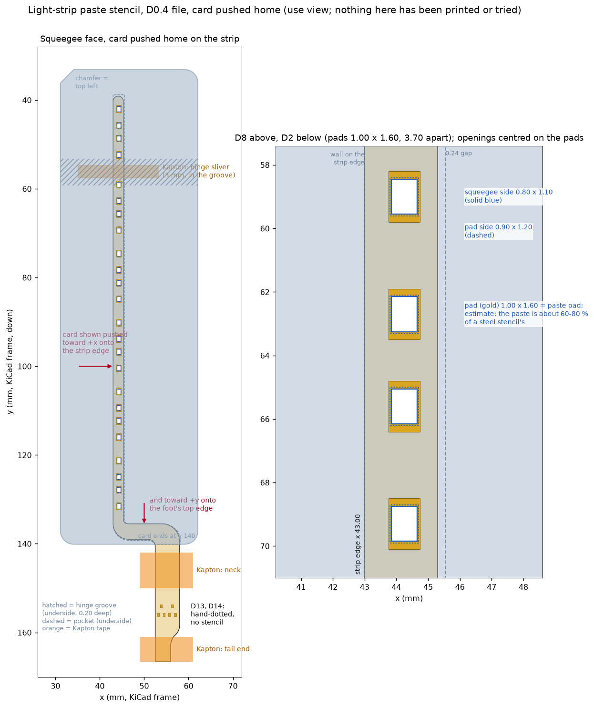
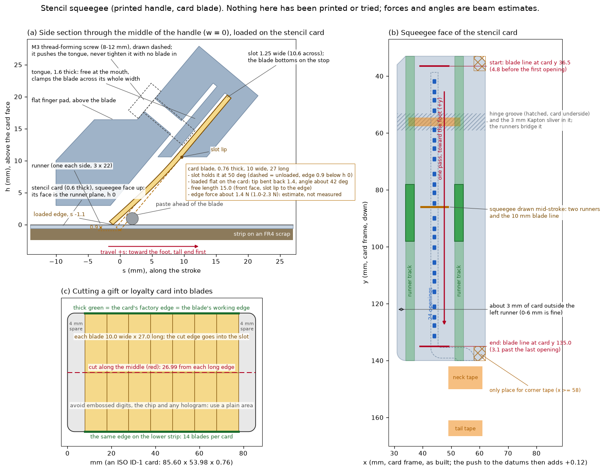
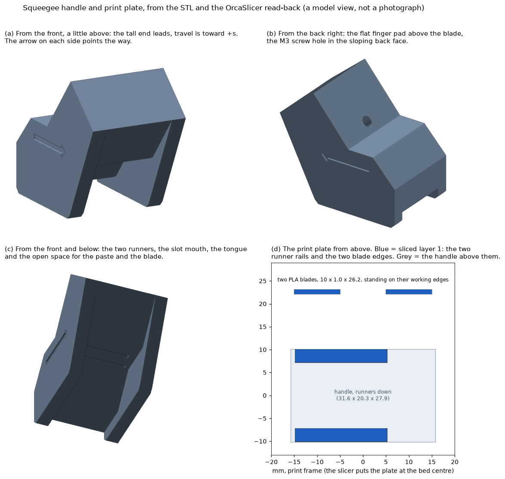

# Assembly and fitting

This guide takes a bare rev A flex through to a working light in a Silkscreen reader: either the **4.26″** reader with a plain `GDEY0426T82` panel, or the **3.68″** x3 reader. Each needs its light-strip case from the [silkscreen-enclosures](https://github.com/iandchasse/silkscreen-enclosures) repo (the `print/` and `enclosures/` paths below are in that repo). You also need a main board with the frontlight driver populated (the driver chip, labelled U10, and the parts around it; the trimmed x3 board keeps all of it).

**The light-strip cases are in development and not released:** the website does not offer them, and no case has been printed around a strip yet.

The reasons behind each step are in [DESIGN.md](DESIGN.md). The showcase source in silkscreen-enclosures (`showcase/`) builds a page that folds the strip into either reader step by step and shows every piece of tape.

**You need:**

- **Soldering:** a fine-tip iron, or hot air with paste. Flux, tweezers and isopropyl alcohol. Or, for the stencil option, a small reflow oven, Sn42Bi58 paste, the printed stencil and, to wipe the paste on, the printed squeegee with an old plastic card ([§2, option](#option-3d-printed-paste-stencil-and-oven-reflow-experimental-untested)).
- **Testing:** a CR2032 coin cell, a multimeter, and a bench supply that can current-limit at 5–10 mA and reach 22 V.
- **Fitting:** Kapton tape, a craft knife, flush cutters.
- **Parts:** 6 × XL-4008WWC (warm), 6 × XL-4008UWC (cool), 2 × BAV70W,115. Buy a few spares. The LEDs are 4 mm long and easy to lose.

Handle the loose strip as ESD-sensitive. It has no ground and no on-board clamp, and the trimmed x3 board has none on these nets either.

---

## 1. Check LED polarity before anything else

A side-view LED can't be rotated to fix a polarity mistake, because rotating it also points the light the other way. The footprint's polarity was worked out from the datasheet, JLC's tape note and LCSC's library parts, but it has not been measured ([DESIGN.md §3.2](DESIGN.md#32-polarity-corrected-once-still-worth-a-diode-test)). Thirty seconds with a coin cell settles it:

1. **Find the window.** It is the clear, yellow-phosphor strip on one long 4.0 × 0.8 mm face.
2. **Hold the LED as it will sit on the strip.** Put it window-side facing right, as if it were lying on the bar with its light going across the screen.
3. **Touch the CR2032's "+" side to the upper terminal and the "−" side to the lower terminal.** "Upper" means the end that points toward the rounded top of the strip.
4. **It should light.** Reverse the cell and it should stay dark.

If it lights only the other way round, **stop and don't solder.** The footprint and routing would then need mirroring. Please open an issue with a photo.

## 2. Solder the parts

Tape the flex flat, LED side (white silkscreen) up.

- **Warm/cool placement.** In every pair, the **warm XL-4008WWC goes in the lower spot**, nearer the foot (D1–D6 in the BOM). The **cool XL-4008UWC goes in the upper spot** (D7–D12). The two parts look identical, so keep the reels apart.
- **LED orientation.** The window faces the bar's inner edge, toward the screen. The **cathode** is the lower pad of each footprint, marked by a short white bar on the outer edge beside it. The anode is the upper pad.
- **LED position.** Seat each LED flat and square, its window just behind the flex's inner edge, not overhanging it.
- **Diodes.** The two BAV70W diodes (D13 and D14 in the BOM) sit side by side on the tail. On each, the single pin (pin 3) points back toward the LEDs.
- **Solder.**
  - Keep each hand joint short: 2–3 s at the lowest temperature that wets.
  - Use very little solder. The LED sits only 0.8 mm tall, and a big fillet can wick up to the window.
  - Nothing is soldered on the **hinge**, the bare 3.6 mm gap between the top pair and the next (white ticks mark its ends). Keep it clean and don't let flux or solder stiffen it.
- **Clean** off the flux with isopropyl alcohol.

### Option: 3D-printed paste stencil and oven reflow (experimental, untested)

**Neither this stencil nor this process has been tried on a strip.** It is here for anyone whose hand soldering keeps going wrong on the loose flex. The checks behind the stencil read the sliced G-code back ([`docs/reports/stencil_slice_check.md`](reports/stencil_slice_check.md)): they show the slicer leaves every opening clear, not that the printed holes stay open or that the joints come out well. Everything below that is not a measured number is an estimate.

The idea: tape the flex flat to a scrap of bare FR4, lay a thin printed card over the LED bar so each pad shows through an opening, wipe paste across it, place the LEDs, and reflow the whole carrier. Nothing sits on a loose strip, and nothing is soldered by hand except the two diodes (or those with paste dots).

**The files** are in [`production/stencil/`](../production/stencil/) ([its README](../production/stencil/README.md) has the short version).

- **The kit: print one file and get everything.** `stencil-kit_cc2.3mf` (Elegoo Centauri Carbon 2, Elegoo PLA) and `stencil-kit_generic.3mf` (OrcaSlicer's Generic Marlin Printer 0.4 nozzle with Generic PLA; the parts fit inside 220 × 210 mm) are OrcaSlicer projects with **one plate**: all three stencil cards (D0.3, D0.4 and D0.5: print all three, use the one that matches your bar, and you do not need a reprint if the measurement turns out off), the squeegee handle with its two PLA blades, and the aperture coupon. The settings below are in the file already, and the squeegee's own 3 walls and Arachne walls are set on the squeegee object only. Open it in OrcaSlicer (the files were written by 2.4.0-dev; an older version may warn that the file is newer), check that the printer and the plate are yours, **and check that the process shows what is below before you slice**: layer height and first layer height 0.10 mm, elephant foot compensation 0, no brim, 2 slow layers, wall generator Classic. The process in the file is a project preset called "Stencil kit 0.10mm @Elegoo CC2 0.4 nozzle" (generic: "... @Generic Marlin 0.4 nozzle"), not a stock preset, because OrcaSlicer's window would otherwise swap the file's values for the stock "0.12mm Fine" ones (0.12 / 0.2 mm layers, elephant foot 0.1, an auto brim) without a warning. That is expected to hold but **has not yet been confirmed by opening the file in the window** (the files were checked through OrcaSlicer's command line only); if the values are the stock ones, set them by hand. Then slice and print. The slicer's estimate is about 1 h 06 min and 14.1 g on the CC2 and about 2 h with the generic profile (its speeds are slow); the squeegee at 0.10 mm layers is about half of it. The single STLs below stay for reprinting one part. The projects are written by OrcaSlicer's command line (`tools/stencil/make_plate.py`) and read back from a slice of the finished file ([`docs/reports/stencil_plate_check.md`](reports/stencil_plate_check.md)): the same toolpath-only evidence as for the single files, and **nothing has been printed**. Another printer: open the kit, switch to your own machine and filament profiles, and check that the layer height and first layer are still 0.10 mm, the elephant foot compensation 0, there is no brim, two slow layers and the Classic wall generator (a printer profile that defaults to Arachne puts slivers into the 0.8 × 1.1 mm openings), and the squeegee object keeps its two settings.
- **The card** is 31 × 107 mm, 0.5-0.7 mm thick, printed in PLA squeegee face down, so it needs no supports. Its underside has a pocket shaped like the strip, 0.12 mm bigger all round. The pocket's ceiling is a 0.20 mm membrane (two 0.10 mm layers) that rests on the strip, and the 24 LED openings go through it.
- **Pick the pocket depth first.** The pocket must be no deeper than the bar, or paste smears under the membrane. Measure the bar with the liner **on**, at 2-3 points between LED pairs (the same measurement as [§5, step 4.1](#5-426-strip-on-the-panel), but here keep the liner in the number: do not subtract it). Take the largest multiple of 0.1 mm that is at least 0.02 mm below your reading:

  | Bar with liner on | File |
  |---|---|
  | 0.32-0.41 mm | `light-strip-stencil_D0.3_print.stl` |
  | 0.42-0.51 mm | `light-strip-stencil_D0.4_print.stl` (the likely one: nominal stack 0.385 mm plus the 0.09 mm liner = 0.475 mm) |
  | 0.52-0.61 mm | `light-strip-stencil_D0.5_print.stl` |

  3M's data sheet gives the liner as 0.09 mm, so a nominal bar reads about 0.475 mm. A reading under about 0.37 mm (the stiffener at its -0.1 mm limit plus the liner) means the liner is off or the reading is wrong. JLC holds the stiffener only to ±0.1 mm, so measure; don't pick from the nominal.
- **Openings.** On the squeegee face each LED pad gets a 0.80 × 1.10 mm opening, widening to 0.90 × 1.20 mm on the pad side, so the paste lets go of the card. The pad is 1.00 × 1.60 mm. The model puts down about 0.20 mm³ per pad before the real print's shrinkage, against about 0.19 mm³ from a standard 0.12 mm steel stencil at 100 %; PLA walls release incompletely, so expect a lean joint, which suits a 0.8 mm tall LED. The openings are cut 0.12 mm toward -x and 0.12 mm toward -y of the pad centres (KiCad x and y), the same 0.12 mm as the pocket clearance, so that pushing the card onto the two edges (step 5) moves each one onto its pad.
- **The diodes D13 and D14 have no openings.** Their 0.45 × 0.70 mm pads are 0.75-0.85 mm apart: an opening a 0.4 mm nozzle can print would put down about 2.5 times too much paste next to those gaps, which is exactly the bridge the bench test looks for. They sit on the tail, which has its own thickness and its own tape, outside the card. Dot them by hand, or solder them with the iron after reflow.
- **Test pads and the gold fingers have no paste on the board**, so the stencil has no openings for them either.

**Print a card alone** (the kit file above already has these settings) with OrcaSlicer (or any slicer) on the Centauri Carbon 2, PLA. Start from the stock "0.12mm Fine @Elegoo CC2 0.4 nozzle" process with "Elegoo PLA" and change:

| Setting | Value | Why |
|---|---|---|
| Layer height, first layer height | 0.10 mm | the membrane is exactly two layers |
| Elephant foot compensation | **0** | the stock 0.1 opens every squeegee-side opening by 0.10 mm per side: wrong taper, more paste |
| Brim | none | a brim leaves a lip on the squeegee face |
| Supports, ironing, arc fitting | off | nothing needs support, ironing would drag across the openings |
| Slow layers | 2 | prints both membrane layers at first-layer speed |
| First layer speed | 30 mm/s | cleaner small holes |
| Wall generator | Classic | Arachne's variable bead widths leave slivers in the 0.8 × 1.1 mm openings (the stock Elegoo Fine process is Classic already; a generic process defaults to Arachne) |

- Load the file as it is: it is already squeegee face down, with the strip-shaped pocket facing up. Don't rotate it or turn on auto-orient.
- Clean the plate with IPA and run the auto-levelling. If the first layer looks translucent and the openings look like slits, the nozzle is too close: raise the Z offset about 0.02 mm and print again.
- Let the plate cool, then flex the plate, not the card. Don't pull on the membrane.
- **Hold the card up to a light.** All 24 openings must be open and clean. Clear any string with a needle from the squeegee side. Don't sand the pad side.
- **Check the scale.** The first and last LED openings (D7's anode and D6's cathode) should be **89.50 mm** apart, centre to centre. If yours is off by more than 0.15 mm, set the slicer's Y scale to 100 × 89.50 / measured, in percent, and print again.
- Print two cards; PLA wears and costs almost nothing. The sliced estimates are 9-11 minutes and 2-3 g each (D0.3 to D0.5).
- **Optional test coupon** (`aperture-coupon_print.stl`, 5 minutes, 1 g): three rows of holes from 0.4 to 1.0 mm in the same 0.2 mm membrane, so you can see where your own printer stops opening them. In the slicer's view, with the chamfered corner at the top left, each row grows from left to right: the middle row is 0.5 × 1.1 up to 1.0 × 1.6, the top row 0.45 × 0.70 up to 0.70 × 1.00, the bottom row squares from 0.4 up to 1.0 mm. The slicer keeps even 0.4 mm holes open; the real print may not. About 0.60 mm on the short side is the smallest opening to count on, 0.45-0.55 mm opens only sometimes, and below that assume it closes. These limits are estimates.

**The squeegee (optional, printed, untested).** The paste is wiped on with a plastic card edge; this handle holds a piece of card at a set angle and pressure, so one pass along the bar fills all 24 openings. **It has not been printed or tried.** The slicer read-back ([`docs/reports/stencil_squeegee_check.md`](reports/stencil_squeegee_check.md)) shows the toolpath is clean and nothing more; every force and angle below is a beam estimate with an assumed card stiffness.

- **Files** (in [`production/stencil/`](../production/stencil/)): the kit file above has the handle and two PLA blades on its plate; `squeegee_print.stl` is the same handle and two spare PLA blades on a plate of their own, already placed (load it as it is: runners on the bed, blades standing on their working edges; don't rotate it); `squeegee-blade-pla_print.stl` is one more blade; `squeegee_params.json` has every dimension and the estimates.
- **You need** the printed handle, one **M3 screw, 8-12 mm long** (any head; it cuts its own thread in the PLA), and a plain plastic card (gift, loyalty or hotel key card, ISO size, 0.68-0.84 mm thick) for the blade. Or use the printed PLA blade.
- **The card blade** is a piece 10.0 mm wide and 27.0 mm long with **one factory edge, which is the working edge**.
  1. Rule a line along the middle of the card, 27 mm from a long edge, and cut along it with scissors (or score it twice with a craft knife and snap it). That gives two strips of 85.6 × 27 mm, each with one factory long edge.
  2. From each strip cut 10.0 mm pieces square to the factory edge, starting at least 4 mm from the rounded ends: up to 7 per strip, 14 per card. A cut error of ±0.3 mm on the 27 mm length changes the pressure by about ±20 %; the width can be 9.5-10.5 mm.
  3. Avoid embossed digits, the chip and any hologram: use a plain area. Hold the edge to a light: it should be straight with no nick or burr. Don't sand it.
- **How it holds the blade.** The slot holds the card at 50° to the stencil, with its edge 0.9 mm lower than the runners' underside. Two runners, each 3 × 22 mm, ride on the **stencil card** (not on the FR4), 3 mm inside its left edge and more than 5.7 mm from the pocket, so with the runners flat the blade is bent back about 1.4 mm: the angle at the tip becomes about 42° and the edge presses with about **1.4 N** (1.0-2.3 N, depending on the card). These are estimates. The runners clear all three tapes and work with all three stencil depths.
- **Clamping.** Push the blade in from the slot mouth, factory edge out, until its cut edge meets the stop. Turn the screw in: it pushes a printed tongue, and the tongue presses the blade across its whole width at the mouth. **Never tighten the screw without a blade in** (the tongue would be strained about 1.8 %; with a blade it is under 1 %). The first time, drive the screw in with no blade only until its tip shows in the back slit, then back it out: that cuts the thread.
- **The two tabs.** So that the tongue prints without supports, its first layer (0.2 mm) is tied to the slot's side walls by one small tab at each side, at the lower ends of the two long side slits next to the slot mouth. Before the first use, press the tongue's free end toward the back with a fingertip or a small screwdriver through the slot mouth: the tabs should snap and the tongue spring free (the first tightening of the screw with a blade in also does it). If a tab does not snap, cut it with a craft knife and pick off the stub. The tongue must move freely before you rely on it to clamp.
- **Print it alone** (`squeegee_print.stl`) on the Centauri Carbon 2 in PLA, from the stock "0.20mm Standard @Elegoo CC2 0.4 nozzle" process with "Elegoo PLA", changing only the settings below. (In the kit file it is printed with the cards at 0.10 mm layers and elephant foot compensation 0, with only its walls set as below; that is slower, and the only effect expected from the elephant foot setting is a slight lip on the bottom edge of the runners and of the PLA blades, to rub off flat on sandpaper. That is an estimate: nothing has been printed.)

  | Setting | Value | Why |
  |---|---|---|
  | Wall loops | 3 | the screw threads into the walls |
  | Wall generator | Arachne | fills the 1.0 mm PLA blades with two even beads |
  | Brim | none | it would sit on the PLA blades' working corners and the runners' edges |
  | Supports | off (the stock value) | nothing needs them: the slicer bridges the ceiling behind the blade, the underside of the slot mouth (the tongue's first layer is part of that bridge, held by its two tabs) and the 1 mm wide ends of the slot and slits |
  | Elephant foot compensation | **0.1 (the stock value: leave it)** | keeps a lip off the runners and the blade corners. This is the opposite of the stencil card, which needs 0 |
  | Everything else | stock | 0.20 mm layers, 15 % infill |

  The slicer's estimate for the whole plate (the handle and two blades) is about 17 minutes and 6.4 g (16 min 37 s in the last read-back; it moves by several percent with where the slicer puts the plate). In the kit file, at 0.10 mm layers, the squeegee takes about 6.7 g and half of the plate's print time.
- **Check it before use.** Stand the squeegee on a flat surface (the FR4 or a table) on its two runners. The blade should bend and touch along its whole edge, with no light under it. If it touches at one corner only, the card is cut crooked or the edge is nicked: try another piece.
- **The PLA blade** (10.0 × 1.0 × 26.2 mm, printed standing on its working edge, no brim) is the fallback. Its end is square and both of its faces are alike, so it is reversible: two working corners. If a lip shows on the corner, hold the blade upright and rub it 3-4 times on 600-grit paper laid flat. If it cracks at the slot mouth (printed cold or under-extruded), use a card blade.
- **Not known** (none of it can be checked by slicing): the real stiffness of your card, and so the real pressure; whether the PLA blade survives bending across its layer lines; how the paste actually rolls and fills with the blade leaning toward the direction of travel (the paste then sits in the acute wedge under it); how well a thread-forming screw holds in printed PLA. If the openings fill unevenly, change the card (thicker is firmer) before changing anything else.

**Paste, tape and carrier.**

- **Paste: low-temperature Sn42Bi58** (melts at 138 °C), for example Chip Quik's SMDLTLFP series (Sn42/Bi57.6/Ag0.4), type 4 or 5. It peaks at about 165-180 °C, against about 215-225 °C for leaded and 240-250 °C for lead-free paste, which is easier on the LEDs' silicone lens, the 3M 9077 tape and the black coverlay (which soaks up infrared and runs hotter than the FR4). The price is brittler joints, acceptable here because every joint sits on a stiffened piece. **Never touch a Bi58 joint up with leaded solder**: tin-lead-bismuth melts near 96 °C. Rework with Bi58 paste or lead-free wire. Keep the paste cold and let it reach room temperature before opening the jar.
- **Tape: Kapton (polyimide film, silicone adhesive).** It is rated far above these temperatures and peels cleanly. No masking or painter's tape.
- **Carrier: a bare FR4 scrap**, flat, with no parts or solder on it (they would reflow too), at least about 40 × 140 mm and small enough for the oven drawer.
- **Keep the release liner on the strip's 9077 tape** through stencilling and reflow. It keeps the adhesive off the FR4, and it is the same liner §5 peels later. It is 0.09 mm thick and rated to 260 °C for short periods (3M's 9077 data sheet), well above the 165-180 °C peak.

**Steps.**

1. **Test one LED** with a coin cell ([§1](#1-check-led-polarity-before-anything-else)).
2. **Practise once** on one of the spoiled strips with a few spare LEDs. It shows how the paste, the card and the oven behave before a good strip goes in.
3. **Measure the bar and pick the file** (above).
4. **Tape the strip.** Clean the FR4 and the strip's top side with IPA. Lay the strip LED side up, liner down, flat and straight. Tape it in three places only:
   - across the hinge, with a sliver 3 mm wide (the card has a groove for it), reaching about 8 mm onto the FR4 each side. Keep it between the white hinge ticks, off the stiffened ends of the bar: there is only about 0.3 mm of room each side before it reaches the next LED pair's openings. Trim it to 2.5 mm wide if unsure;
   - across the neck;
   - across the tail end, over the gold fingers.

   No tape on the bar, the top piece or the foot: the card bears there.
5. **Lay the card over the strip**, pocket side down, so the strip drops into the pocket. Push it toward the LED-window side (+x) until the pocket wall meets the strip's straight outer edge, and toward the foot (+y) until the wall above the foot meets the foot's top edge. Look through the openings: gold pad should show all round each one. Hold the card down beside the bar, or tape its two far corners to the FR4 with Kapton, on the card's right-hand 4 mm only (x 58-62) so the squeegee's runners clear the tape.
6. **Print the paste** (with the squeegee above; the last bullet is for no squeegee).
   - **Paste.** Put a bead about 8 mm long and 2-3 mm thick (about 0.1 g, a little more than a grain of rice) across the column of openings, centred on it, 3-4 mm above the top LED's openings (card y about 37-39). The 24 openings take only about 0.02 g; the rest rolls ahead of the blade and is wiped off at the end.
   - **Place.** Set the squeegee down behind the bead, on the top-piece side, with the tall end toward the foot (the arrows point that way). Keep the column of openings centred between the two runners, with about 3 mm of card showing outside the left runner (0-6 mm is fine).
   - **Press.** Put an index finger on the flat pad above the blade and press until both runners sit flat on the card. The runners set the angle and the pressure; pressing harder only presses the runners down, so just keep them flat.
   - **One pass, toward the foot only.** Pull in one steady stroke, about 10-20 mm/s (5-10 s for the length), without stopping over an opening. **Never stroke back toward the top or sideways**: that drags the card off its two datums.
   - **Lift off.** Stop with the blade 3-5 mm past the last opening (card y about 135-137), then lift the squeegee straight up, slowly. Wipe the leftover bead off the card and the blade with a tissue; don't put used paste back in the jar. If an opening is not full, make one more pass the same way with a fresh small bead. Then lift the card straight up, starting at the top end. Don't let it slide.
   - **Clean the squeegee straight away,** before the flux dries: loosen the screw, take the blade out, and wipe the blade, the slot mouth and the runners with isopropyl alcohol on a lint-free tissue. PVC and PLA both take it; **no acetone** (it softens PVC). Replace a card blade when its edge shows a nick against the light; turn a PLA blade over to use its second corner.
   - **No squeegee?** A 10-15 mm piece of old plastic card held by hand at about 45° still works, and so does a flat metal spatula; the angle and the pressure are then up to your hand.
7. **Inspect.** Each pad should have a neat brick. Wipe a smeared pad with a cotton bud and IPA, let it dry, and re-print or dot it. Wash the card with IPA straight away.
8. **Diodes.** Dot paste by hand on the six pads of D13 and D14, about 0.3 mm dots (a fine needle or a toothpick). Or leave them dry and iron them on after reflow: with the strip taped flat, that is much easier than on a loose one.
9. **Place the parts** with tweezers, pressing each lightly into the paste. Do all six of one colour from one reel, then the other.
   - **Warm XL-4008WWC in the lower spot** of every pair (D1-D6, nearer the foot), **cool XL-4008UWC in the upper spot** (D7-D12).
   - Window toward the bar's inner edge, **cathode on the lower pad**, seated flat and square with the window just behind the flex edge.
   - BAV70W: pin 3 toward the LEDs.
10. **Reflow** (below). Leave the oven shut until it reads below about 60 °C, then let the carrier reach room temperature. The flex and its tape are soft while hot. Peel the Kapton slowly, folded back on itself and away from the LEDs.
11. **Clean and test.** Wash off the flux with IPA, check with a loupe for bridges (D13/D14 above all) and for solder near the windows, then do the bench test in §3.

**Puhui T-962 notes** (general advice; the exact profiles and hot spots of your unit are not known):

- **Profile.** Use one that matches the paste's datasheet: preheat to about 90-120 °C, soak, peak about 165-180 °C, 30-60 s above 138 °C, then cool. If the oven offers only leaded and lead-free presets, the leaded one (lowest peak) is the closest. Watch through the window: the paste turns from dull grey to shiny when it melts.
- **The readout is not the board's temperature.** The thermocouple reads air near the lamps, and the stock unit heats unevenly. Put the carrier in the middle of the drawer with the strip along the drawer's long side. The practice run shows where it reflows first and last; turn the carrier round between runs if the far end lags.
- **First runs smoke.** The stock oven has paper masking tape inside that smokes and smells at first. Run it once empty, ventilated.
- **Don't open the drawer at peak** to cool faster: the thermal shock and the jolt can move parts while the solder is liquid.

**What can go wrong, and what is not known:**

- **A gap under the membrane** (a pocket deeper than the bar) lets paste smear under it. Measure first.
- **Printed holes shrink** with first-layer squish and ooze; the slicer check cannot see that. Look at the card against a light.
- **The top piece is placed only by the hinge tape**, so check by eye that its two openings show gold.
- **Print scale** drifts along the 94 mm from the foot; hence the 89.50 mm check.
- **The oven's uneven heat** is why the practice run comes first.
- **The squeegee is untested.** Its pressure and angle are estimates; a card that is too soft or too stiff, a crooked cut or a nicked edge leaves some openings short. Practise on a spoiled strip first.

*Rebuilding the files:* after any footprint or outline change, rerun `tools/stencil/extract_paste.py` with KiCad's Python and `stencil.py`, `slice_check.py`, `squeegee.py --slice`, `make_plate.py` (the two kit projects; it needs OrcaSlicer's command line) and `render.py` in a Python with CadQuery, shapely and trimesh, and commit `production/stencil/`.

## 3. Bench test on the pads

Test before the strip goes anywhere near a panel. Three pads on the tail each have a letter **directly below** them:

- **S** = LED_SW, the anode supply. It is the lower-left pad, with a via in its centre.
- **C** = C−, the cool return.
- **W** = W−, the warm return.

1. **Coin-cell every LED first.** A CR2032 across any single LED's two pads, "+" on the upper pad, lights just that LED. One that won't light is reversed, badly soldered or open. Fix it now: the supply test below can over-stress a reversed LED.
2. **Check for shorts.** With a meter on the diode range, **S–C and S–W must read open (OL) in both directions.** A reading means a solder bridge, usually at D13/D14 or a test pad. Don't fit a strip that fails this: on the reader, that short puts the battery or USB across the main board's 15 Ω current-set resistor (R37) with no regulation, about 0.3 A, even with the light off.
3. **Set the supply** to a **5–10 mA current limit** and 0 V.
4. **Cool string.** Connect **+ to S** and **− to C**, and raise the voltage slowly. The six cool LEDs should light together at about 16–20 V, depending on bin and temperature.
5. **Warm string.** Move **− to W**. The six warm LEDs should light.
6. **Stop at 21 V.**
   - If nothing lights by 21 V, a string is open or has an LED in backwards. Go back to step 1. A single backwards LED already sees more than its 5 V reverse rating from about 16.5 V up, so don't dwell there.
   - If the supply sits in current limit with the voltage stuck near 0 V, S is shorted to C or W. See step 2.
   - If a string needs **more than about 20.5 V** at room temperature to reach 10 mA, note it: that batch's LEDs are on the high side, and a cold reader could pass the 22 V design ceiling (still under the driver's 24.25 V shutoff; [DESIGN.md §2.1](DESIGN.md#21-six-leds-per-string)).

## 4. Which reader, which case

| | 4.26″ | 3.68″ |
|---|---|---|
| Panel | Plain **GDEY0426T82** (no touch, no frontlight). The FT01C does not fit the light-strip case. | The x3's 3.68″ 528 × 792 panel |
| Case (in development) | Plate 2 of `print/silkscreen-426-plates.3mf` (or `print/4.26/`: the shared parts plus **`tub-light-strip`**) | Plate 2 of `print/silkscreen-368-plates.3mf` (or `print/3.68/`: the shared parts plus **`tub-light-strip`** and four **`key-x3ls`**) |
| Where the strip goes | **On** the panel's left border | **Beside** the panel, in a channel in the tub; the top pair folds back under the bar |
| Order | Strip onto the panel, then the whole stack into the tub | Strip into the tub first, then the panel |
| Read | [§5](#5-426-strip-on-the-panel) | [§6](#6-368-fold-back-and-fit-beside-the-panel) |

Both case READMEs have a "Light-strip variant" section with the measured numbers behind these steps.

## 5. 4.26″: strip on the panel

1. **Trim the Back button's left mounting-lug lead.** The Back button is the leftmost of the four bottom-row buttons (seen from the front), labelled SW9 on the board. Its lead stands on the board's front just left of the slot, next to where the strip's neck passes (KiCad about x 52.2, y 143.9). As it comes, its tip is 0.71 mm proud of the board and 0.10 mm from the neck. Cut it flush (at most 0.1 mm proud) and cover it with Kapton.
2. **Kapton on the slot edges.** Put Kapton on both edges of the board's FPC slot where the neck passes (the left end of the slot).
3. **Prepare the panel.** Peel its thin shipping film (0.065 mm) at least where the case's stops and the strip land, and its pull tape. Clean the left and bottom borders with isopropyl alcohol, not the active area. Leave the panel's own protective sheet on.
4. **Lay the strip.**
   1. **Measure it first.** With a micrometer, measure the bar (flex + stiffener + tape) at 2–3 points between LED pairs, with the liner on, and subtract the liner (0.09 mm, per 3M's data sheet). It should be **0.37–0.40 mm**: the case's hold-down pads sit only 0.015 mm over a nominal strip, and JLC holds the stiffener to ±0.1. If it is thinner, stick 0.05 mm Kapton on each hold-down pad face in the tub (two layers below 0.32). If it is more than 0.03 mm thicker, scrape the pad faces back.
   2. Peel the liners off the two taped pieces: the short top-pair piece and the long bar + foot.
   3. Lay the bar with its straight outer edge **0.1 mm inside the panel's left glass edge** (0 to 0.2 mm). It must never overhang the glass, or it scrapes the case wall when the stack goes in. Much further in, the neck moves onto the panel's own FPC.
   4. The rounded top sits about 1.3 mm below the top glass edge. The foot lies along the bottom border on the flat protective sheet.
   5. The hinge between the top two pairs lies flat and untaped on this reader.
   6. Tack one end, check the alignment along the whole length, then press the rest down with a soft tool. **Press on the flex between the LEDs, not on the LEDs.**
   7. Check that every window faces the screen and sits just outside the image area (about 1.2 mm outside it).
5. **Wrap the U.** Wrap the neck 180° around the bottom glass edge, inside radius about 0.7–0.9 mm (a 1.5–1.8 mm drill shank is a good former). **Never crease it**: the glass edge is bare and sharp.
   - Keep the wrap square to the glass edge. The neck's right edge is only 0.2–0.8 mm from the panel's own FPC; the U must not ride onto, press on or pull that FPC's bond or bend area.
   - The spare 0.5–2.2 mm of tail stays in the U; don't let the loop balloon toward the board.
6. **Board.** Take the tail through the board's slot and into the frontlight connector ([§7](#7-plug-into-the-frontlight-connector-j3)).
7. **Into the case.** Stack the panel and strip, then the midplate, then the board, as in the case README (section 6). **Push the stack into the tub with the glass kept toward the right-hand wall** (held there, not pressed hard), so the bar stays clear of the left wall on the way in. The case's hold-down pads land between the LED pairs, off their solder joints.

## 6. 3.68″: fold back and fit beside the panel

On this reader the strip goes into the tub **before** the panel.

1. **Fold the top pair back.**
   1. The long bar + foot piece has one liner. With a craft knife, lightly score that liner (not the tape) across the bar about 16 mm below the hinge, and again where the bar meets the foot.
   2. Peel the top-pair piece's liner and the bar's liner above the first score.
   3. Fold the top pair **180° backward** at the hinge, under the bar, tape to tape. The bare hinge forms an open loop at the bar's end. **Do not crease it**, and keep the folded piece's edges in line with the bar's. Its LEDs now face the back.
2. **Leave the rest of the bar's liner on.** It can't be pressed onto the seat inside the tub. The bar is held anyway: it is trapped between the seat and the skin, the ribs place it sideways, and the foot places it along its length.
3. **Put the strip in the tub.** Tub face down:
   1. Lay the bar in about 0.5 mm right of its place, LEDs down toward the skin. It drops past the seat's edge.
   2. Slide it left, under the seat, **against the six small ribs** on the channel's side wall. The foot comes with it into its pocket.
   3. The folded pair and its loop drop straight into the fold zone, which is open from the back.
   4. Let the neck and tail hang out past the pocket's bottom edge.
4. **Peel the foot's liner.** Then fit the panel as in the x3 README: glass to the lip, its own FPC at the bottom, its left edge against the two corner stops. The midplate springs press the panel's film onto the foot's tape.
5. **Midplate, then the board.**
   - Kapton on the slot's edges where the neck passes, and on the Back button's (SW9's) pin just below the slot.
   - Fold the neck over the glass edge and through the board's slot, 6.5 mm left of the panel's FPC.
   - Plug the tail into the frontlight connector ([§7](#7-plug-into-the-frontlight-connector-j3)).
   - This reader leaves **4–5.6 mm of spare tail**. Leave it as a loop between the slot and the stiffened end on the board's back (it stands about 2–3 mm off the board; the lid clears it). Part of it can sit in the chin instead, where the case's neck gap takes a small loop.

## 7. Plug into the frontlight connector (J3)

The frontlight connector is on the back of the main board, labelled J3. It is a back-flip ZIF: the lever is on the side away from the opening.

1. Flip the lever open.
2. Insert the contact tab. **Its gold contacts face away from the board**, which also means the diodes and the S/C/W labels face you.
3. Push the tab in **fully**, about 2.9 mm. The full 3.5 mm width runs only about 3.8 mm from the tip before the tail starts to widen, so about 1 mm of it stays visible outside the mouth.
4. The white **triangle** marks contact 1. The fold keeps the pin order, so it lands on the connector's pin 1 by itself.
5. Close the lever.
6. **Strap the stiffened end** to the board's back with Kapton, between the test pads and the connector's mouth. The connector holds with only about 3 N, so the tape should take any pull.
   - The strap goes over the **stiffened** part only; the loop of spare tail (3.68″) stays free.
   - The back run passes over the main board's W− test point (TP5 in the schematic; it has no label on the board). Leave it unpopulated and flush.

A tail inserted upside down is harmless: the strip stays dark and the driver latches off. Turn it over and re-seat it.

## 8. The case

The light-strip cases are in development and not released; this section records what they need.

- **4.26″ (`enclosures/case-426`):**
  - Print the light-strip tub in a **dark or opaque** filament. Over the LEDs the skin is 0.6 mm, and a light colour may glow. Or line the raised ceiling with black tape before fitting.
  - The springs push the plain panel a little less than the FT01C: 6.5 N in all at nominal, against 8.2 N.
  - The left window edge has a 0.2 mm bevel instead of 0.6, so it looks slightly different from the other three.
- **3.68″ (`enclosures/case-368`):**
  - Print plate 2 of `print/silkscreen-368-plates.3mf`, or from `print/3.68/` the shared parts with `tub-light-strip` and four `key-x3ls`. The shell is 13.7 mm deep (the standard build: 12.9). Since 2026-10-12 the lid has 1.0 mm more air behind the board so that it closes over a Rev 1.0 board's charging wires, and since 2026-10-19 another 0.2 for a 6.02 mm cell with its tape (13.5 and 12.7 before; 12.5 and 11.7 before 2026-10-12; 11.3 before the standard build's screen bevel).
  - The bottom keys (`key-x3ls`) stand 1.5 mm proud of the raised face, 0.8 mm taller than the standard build's (`key-x3std`); the cranks, rod and gate are the same in both builds.
  - On the first print, check that the seat's underside is flat and that the light looks even past the hold-down pads.
- **Both:** look straight on with the case closed. No flex or LED should be visible. At steep side angles a dark sliver of the black coverlay may show.
- **Antenna.** The bar passes 5–8 mm from the ESP32-S3 antenna. Compare the Wi-Fi RSSI with and without the strip on the first build.

## 9. Firmware bring-up

The strip is electrically a stock frontlight ([silkscreen-pcb HARDWARE.md §7](https://github.com/iandchasse/silkscreen-pcb/blob/master/docs/HARDWARE.md#7-frontlight-driver)).

1. **Choose a colour.** With the light off, set `COLOR_SEL` (IO40): LOW selects cool, HIGH selects warm. A pull-down on the main board (R75) holds it LOW at boot.
2. **Enable.** Drive `PWM_LED` (IO42, ADIM) **HIGH for at least 100 µs**. A bare PWM carrier may never enable the driver.
3. **Dim.** Start PWM at 10–200 kHz from a low duty and ramp up. Dimming is analog inside the driver, so it doesn't flicker.
4. **Check `LED_MONIT`** (IO2, ADC1_CH1) over the first second after enabling, keeping the peak:

   | Reading | Meaning |
   |---|---|
   | 0.27–0.56 V | Off (tracks the battery or USB) |
   | **1.4–2.4 V** | **Lit** at full duty |
   | peak **≥ 2.49 V** (about 2.5–2.7 V) | Strip open, flipped or unplugged. The driver trips its over-voltage limit and latches off after 3 trips, then stops switching, and `LED_MONIT` sinks back to the off band over several seconds. **Record the fault when you first see it.** |
   | below 1.30 V at full duty, 50 ms or more after enabling | Shorted LEDs or a solder bridge |

   The first layout's 2.2 V "open" threshold is too low for six LEDs: a cold strip can read 2.32 V.
5. **Recover from a latch.** Hold `PWM_LED` **LOW for at least 3 ms**, fix the cause, then enable again. PWM alone won't restart it.
6. **Change colour** only with the duty at 0: ramp down, switch `COLOR_SEL`, ramp back up.
   - Keep the time at duty 0 under about 1 ms. `ADIM` LOW for more than 2.5 ms shuts the driver down, and a low-duty carrier won't re-enable it.
   - If the pause may be longer, send the ≥ 100 µs HIGH enable pulse again before ramping up.

A faint glow from the unselected string in a dark room is normal: a few µA leak through the main board's 1 MΩ bleeder. The stock panel does the same.

## Troubleshooting

| Symptom | Likely cause |
|---|---|
| Nothing lights; `LED_MONIT` 2.5–2.7 V within the first second, then falling to the off band | Tail flipped or not fully seated, or an LED reversed or open. Bench-test on S/C/W. |
| Nothing lights; `LED_MONIT` in the off band with PWM running | The driver never enabled (check the ≥ 100 µs HIGH pulse), or it latched open earlier and the driver's output capacitor (C9) has drained since. Hold `PWM_LED` LOW for ≥ 3 ms, re-enable, and read again. |
| `LED_MONIT` about 0.45 V at boot and the board warm near the current-set resistor (R37) | S shorted to C or W on the strip. Unplug it and do the meter check in §3. |
| One colour works, the other doesn't | Open joint or reversed LED in that string, or a BAV70W joint. Coin-cell each LED. |
| Only the 3.68″'s top pair seems dark | Normal: it is folded under the bar and faces the back. |
| Light flickers when the reader is tapped | The frontlight connector's lever not closed, or the tail pulling on the connector. Re-seat it and strap the back run. |
| `LED_MONIT` below 1.30 V at full duty, with the LEDs lit | Shorted LEDs or a solder bridge across part of a string. Power off: a string shorted out entirely draws current with no regulation. |
| Bright band right at the left edge, dim right side | Expected with grazing light. See [DESIGN.md §6](DESIGN.md#6-optics). |
