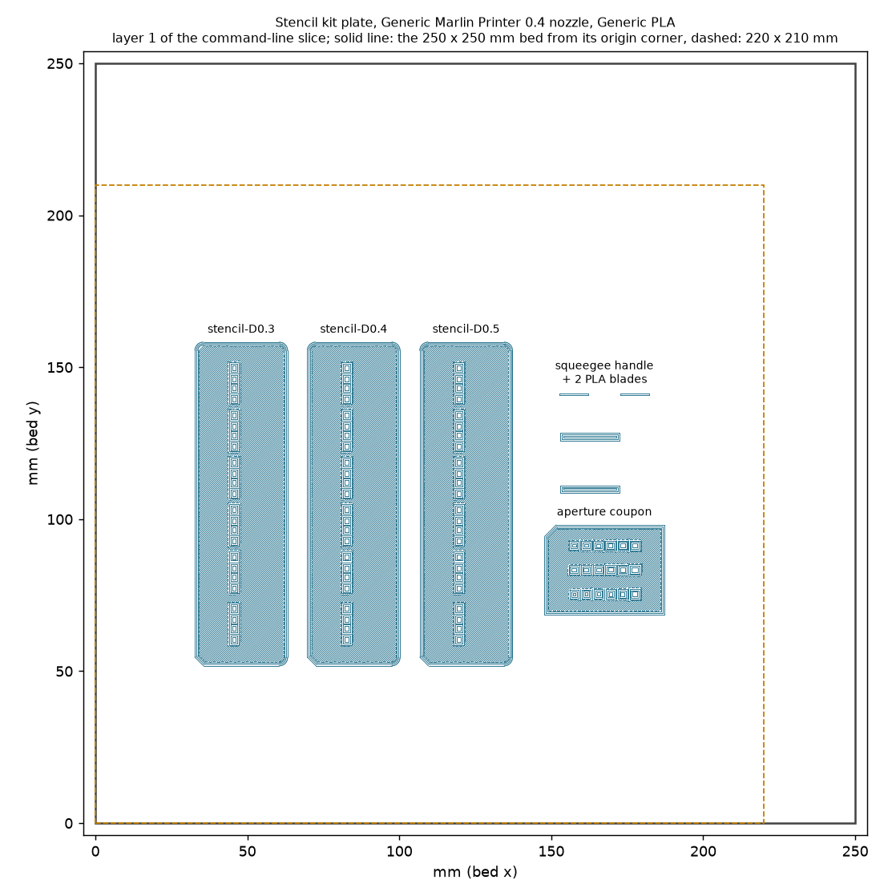
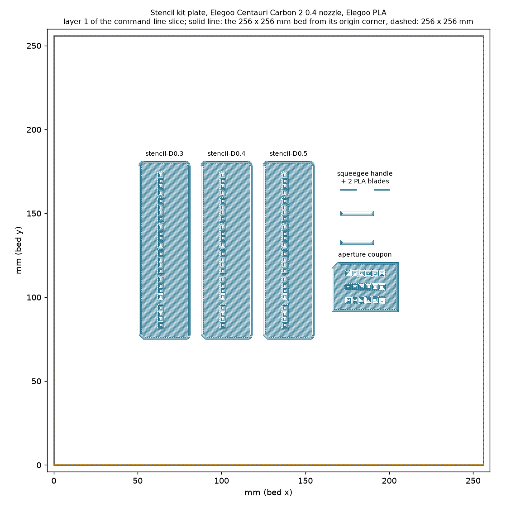

# Stencil kit plate check

Generated by `tools/stencil/make_plate.py`. Each `production/stencil/stencil-kit_*.3mf` is written by OrcaSlicer itself (its command line, never its window), then read back from the file and from one command-line slice of that file. **A toolpath and file check only: nothing here has been printed**, and the slicer cannot say whether the printed openings stay open (see `docs/ASSEMBLY.md`).

## generic: Generic Marlin Printer 0.4 nozzle, Generic PLA

File `production/stencil/stencil-kit_generic.3mf`, 407212 bytes, sha256 `07451b03dcfbe43d`. Presets (names as OrcaSlicer holds them): machine `MyMarlin 0.4 nozzle`, process `Stencil kit 0.10mm @Generic Marlin 0.4 nozzle` (the flattened stock `0.12mm Fine @MyMarlin` with the overrides below, under a name no stock preset has, so that the OrcaSlicer GUI does not replace its values with the stock preset's on opening), filament `Generic PLA @System`. Bed 250 x 250 mm; the parts fill 32.5..187.5 x 51.5..158.5 mm, inside 220 x 210.

| Check | Result |
|---|---|
| Parts in the project | stencil-D0.3, stencil-D0.4, stencil-D0.5, squeegee-handle-and-2-blades, aperture-coupon |
| Position against the plan, worst error | 0.0000 mm; none rotated; all on the bed (z 0) |
| Mesh against its STL, worst volume error | 1.0e-07 |
| Per-object settings | squeegee object only: {'wall_loops': '3', 'wall_generator': 'arachne'}; the cards and the coupon carry none |
| Project settings | 635 keys (a plain OrcaSlicer export of the same presets and overrides has 635, of the stock presets 635); `filament_colour` present; unchanged by an OrcaSlicer read and write; 8 values differ from an export of the stock presets: brim_type, brim_width, initial_layer_print_height, initial_layer_speed, layer_height, print_settings_id, slow_down_layers, wall_generator |
| Overrides on the stock process | `layer_height` = 0.1, `initial_layer_print_height` = 0.1, `elefant_foot_compensation` = 0, `brim_type` = no_brim, `brim_width` = 0, `enable_support` = 0, `ironing_type` = no ironing, `enable_arc_fitting` = 0, `slow_down_layers` = 2, `initial_layer_speed` = 30, `wall_generator` = classic |
| G-code header | layer 0.1, first layer 0.1, elephant-foot compensation 0, walls 3 / classic (process), sequence by layer |
| Line types | Bottom surface, Bridge, Custom, Gap infill, Inner wall, Internal Bridge, Internal solid infill, Outer wall, Overhang wall, Sparse infill, Top surface (no support, brim, skirt, ironing; 0 arc moves outside the start/end G-code) |
| Slicer estimate, whole plate | 2h 1m 18s, 14.04 g |
| Filament by part (from the G-code, g) | stencil-D0.3 1.87, stencil-D0.4 2.24, stencil-D0.5 2.61, squeegee-handle-and-2-blades 6.37, aperture-coupon 0.78 |
| Share of the extruding time by part (rough: move length over feed rate) | stencil-D0.3 15 %, stencil-D0.4 17 %, stencil-D0.5 19 %, squeegee-handle-and-2-blades 43 %, aperture-coupon 6 % |
| stencil-D0.3 | apertures free on layers 1+2 24/24 (worst bead cover 0.0 mm2); smallest open width 0.8; worst off-centre 0.0; membrane = layers 1 and 2 (0.10 + 0.10 = 0.20 mm) printed 99.2% / 99.6% of its area, layers 3 and up empty inside the pocket (worst 0.0 mm2); datum walls all; floating 0.0061 mm2; 5 layers |
| stencil-D0.4 | apertures free on layers 1+2 24/24 (worst bead cover 0.0 mm2); smallest open width 0.8; worst off-centre 0.0; membrane = layers 1 and 2 (0.10 + 0.10 = 0.20 mm) printed 99.2% / 99.6% of its area, layers 3 and up empty inside the pocket (worst 0.0 mm2); datum walls all; floating 0.0321 mm2; 6 layers |
| stencil-D0.5 | apertures free on layers 1+2 24/24 (worst bead cover 0.0 mm2); smallest open width 0.8; worst off-centre 0.0; membrane = layers 1 and 2 (0.10 + 0.10 = 0.20 mm) printed 99.2% / 99.6% of its area, layers 3 and up empty inside the pocket (worst 0.0 mm2); datum walls all; floating 0.0705 mm2; 7 layers |
| squeegee-handle-and-2-blades | 278 layers; floating islands in the sliced layers (0.5 mm2 or more, sparse infill aside; the clamp tongue's first layer is the one that mattered) 0, in the model sections at 0.10 mm 0; sparse-infill stubs inside the walls 0; extrusion outside the design 0.0 mm2; slot open 1.25 (design 1.25), back slit 0.79, side slits 0.79 (0.80), screw hole 2.56 (2.6); PLA blade layers >= 99.4%; bridges {3.1: 285.1, 10.7: 142.3, 20.6: 66.7, 22.2: 126.7} |
| clamp tongue's tabs | the 6 probe points at the two tabs are extruded in the layers [10.7, 10.8] (z; the mouth plane is at h 10.59, the tabs end at h 10.80), so the tongue's first layer is tied to the slot walls and is not an island; the side slits are open in the layers above ([10.9, 11.0, 11.1]) |
| aperture-coupon | 6 layers; membrane printed 99.2%; channels above it empty (worst 0.0 mm2) |

Per-object settings take effect: the squeegee has 137 distinct wall widths and 97096 mm of wall with them, 4 and 97213 mm in the same slice without them.

Aperture coupon: the open stretch through each hole centre in the sliced layers 1 and 2, along x and along y, against the designed hole:

| hole as designed, x by y (mm) | open width through the centre, layer 1 (x by y) | layer 2 |
|---|---|---|
| 1.1 x 0.5 | 1.1 x 0.5 | 1.1 x 0.5 |
| 1.1 x 0.6 | 1.1 x 0.6 | 1.1 x 0.6 |
| 1.1 x 0.7 | 1.1 x 0.7 | 1.1 x 0.7 |
| 1.1 x 0.8 | 1.1 x 0.8 | 1.1 x 0.8 |
| 1.3 x 0.9 | 1.3 x 0.9 | 1.3 x 0.9 |
| 1.6 x 1.0 | 1.6 x 1.0 | 1.6 x 1.0 |
| 0.7 x 0.45 | 0.7 x 0.45 | 0.7 x 0.45 |
| 0.75 x 0.5 | 0.75 x 0.5 | 0.75 x 0.5 |
| 0.8 x 0.55 | 0.8 x 0.55 | 0.8 x 0.55 |
| 0.9 x 0.6 | 0.9 x 0.6 | 0.9 x 0.6 |
| 0.9 x 0.65 | 0.9 x 0.65 | 0.9 x 0.65 |
| 1.0 x 0.7 | 1.0 x 0.7 | 1.0 x 0.7 |
| 0.4 x 0.4 | 0.4 x 0.4 | 0.4 x 0.4 |
| 0.5 x 0.5 | 0.5 x 0.5 | 0.5 x 0.5 |
| 0.6 x 0.6 | 0.6 x 0.6 | 0.6 x 0.6 |
| 0.7 x 0.7 | 0.7 x 0.7 | 0.7 x 0.7 |
| 0.8 x 0.8 | 0.8 x 0.8 | 0.8 x 0.8 |
| 1.0 x 1.0 | 1.0 x 1.0 | 1.0 x 1.0 |

## cc2: Elegoo Centauri Carbon 2 0.4 nozzle, Elegoo PLA

File `production/stencil/stencil-kit_cc2.3mf`, 407405 bytes, sha256 `abeb2509ee3e96a3`. Presets (names as OrcaSlicer holds them): machine `Elegoo Centauri Carbon 2 0.4 nozzle`, process `Stencil kit 0.10mm @Elegoo CC2 0.4 nozzle` (the flattened stock `0.12mm Fine @Elegoo CC2 0.4 nozzle` with the overrides below, under a name no stock preset has, so that the OrcaSlicer GUI does not replace its values with the stock preset's on opening), filament `Elegoo PLA @ECC2`. Bed 256 x 256 mm; the parts fill 50.5..205.5 x 74.5..181.5 mm, inside 256 x 256.

| Check | Result |
|---|---|
| Parts in the project | stencil-D0.3, stencil-D0.4, stencil-D0.5, squeegee-handle-and-2-blades, aperture-coupon |
| Position against the plan, worst error | 0.0000 mm; none rotated; all on the bed (z 0) |
| Mesh against its STL, worst volume error | 1.7e-07 |
| Per-object settings | squeegee object only: {'wall_loops': '3', 'wall_generator': 'arachne'}; the cards and the coupon carry none |
| Project settings | 636 keys (a plain OrcaSlicer export of the same presets and overrides has 636, of the stock presets 636); `filament_colour` present; unchanged by an OrcaSlicer read and write; 8 values differ from an export of the stock presets: brim_type, brim_width, elefant_foot_compensation, initial_layer_print_height, initial_layer_speed, layer_height, print_settings_id, slow_down_layers |
| Overrides on the stock process | `layer_height` = 0.1, `initial_layer_print_height` = 0.1, `elefant_foot_compensation` = 0, `brim_type` = no_brim, `brim_width` = 0, `enable_support` = 0, `ironing_type` = no ironing, `enable_arc_fitting` = 0, `slow_down_layers` = 2, `initial_layer_speed` = 30, `wall_generator` = classic |
| G-code header | layer 0.1, first layer 0.1, elephant-foot compensation 0, walls 3 / classic (process), sequence by layer |
| Line types | Bottom surface, Bridge, Custom, Gap infill, Inner wall, Internal Bridge, Internal solid infill, Outer wall, Overhang wall, Sparse infill, Top surface (no support, brim, skirt, ironing; 0 arc moves outside the start/end G-code) |
| Slicer estimate, whole plate | 1h 5m 49s, 14.11 g |
| Filament by part (from the G-code, g) | stencil-D0.3 1.85, stencil-D0.4 2.21, stencil-D0.5 2.57, squeegee-handle-and-2-blades 6.65, aperture-coupon 0.76 |
| Share of the extruding time by part (rough: move length over feed rate) | stencil-D0.3 13 %, stencil-D0.4 14 %, stencil-D0.5 16 %, squeegee-handle-and-2-blades 51 %, aperture-coupon 6 % |
| stencil-D0.3 | apertures free on layers 1+2 24/24 (worst bead cover 0.0 mm2); smallest open width 0.8; worst off-centre 0.0; membrane = layers 1 and 2 (0.10 + 0.10 = 0.20 mm) printed 99.2% / 99.8% of its area, layers 3 and up empty inside the pocket (worst 0.0 mm2); datum walls all; floating 0.0013 mm2; 5 layers |
| stencil-D0.4 | apertures free on layers 1+2 24/24 (worst bead cover 0.0 mm2); smallest open width 0.8; worst off-centre 0.0; membrane = layers 1 and 2 (0.10 + 0.10 = 0.20 mm) printed 99.2% / 99.8% of its area, layers 3 and up empty inside the pocket (worst 0.0 mm2); datum walls all; floating 0.0023 mm2; 6 layers |
| stencil-D0.5 | apertures free on layers 1+2 24/24 (worst bead cover 0.0 mm2); smallest open width 0.8; worst off-centre 0.0; membrane = layers 1 and 2 (0.10 + 0.10 = 0.20 mm) printed 99.2% / 99.8% of its area, layers 3 and up empty inside the pocket (worst 0.0 mm2); datum walls all; floating 0.0012 mm2; 7 layers |
| squeegee-handle-and-2-blades | 278 layers; floating islands in the sliced layers (0.5 mm2 or more, sparse infill aside; the clamp tongue's first layer is the one that mattered) 0, in the model sections at 0.10 mm 0; sparse-infill stubs inside the walls 1; extrusion outside the design 0.001 mm2; slot open 1.25 (design 1.25), back slit 0.76, side slits 0.80 (0.80), screw hole 2.57 (2.6); PLA blade layers >= 99.4%; bridges {3.1: 270.2, 10.7: 141.5, 20.6: 66.3, 22.2: 132.4} |
| clamp tongue's tabs | the 6 probe points at the two tabs are extruded in the layers [10.7, 10.8] (z; the mouth plane is at h 10.59, the tabs end at h 10.80), so the tongue's first layer is tied to the slot walls and is not an island; the side slits are open in the layers above ([10.9, 11.0, 11.1]) |
| aperture-coupon | 6 layers; membrane printed 99.4%; channels above it empty (worst 0.0 mm2) |

Per-object settings take effect: the squeegee has 145 distinct wall widths and 96977 mm of wall with them, 4 and 97127 mm in the same slice without them.

Aperture coupon: the open stretch through each hole centre in the sliced layers 1 and 2, along x and along y, against the designed hole:

| hole as designed, x by y (mm) | open width through the centre, layer 1 (x by y) | layer 2 |
|---|---|---|
| 1.1 x 0.5 | 1.1 x 0.5 | 1.1 x 0.5 |
| 1.1 x 0.6 | 1.1 x 0.6 | 1.1 x 0.6 |
| 1.1 x 0.7 | 1.1 x 0.7 | 1.1 x 0.7 |
| 1.1 x 0.8 | 1.1 x 0.8 | 1.1 x 0.8 |
| 1.3 x 0.9 | 1.3 x 0.9 | 1.3 x 0.9 |
| 1.6 x 1.0 | 1.6 x 1.0 | 1.6 x 1.0 |
| 0.7 x 0.45 | 0.7 x 0.45 | 0.7 x 0.45 |
| 0.75 x 0.5 | 0.75 x 0.5 | 0.75 x 0.5 |
| 0.8 x 0.55 | 0.8 x 0.55 | 0.8 x 0.55 |
| 0.9 x 0.6 | 0.9 x 0.6 | 0.9 x 0.6 |
| 0.9 x 0.65 | 0.9 x 0.65 | 0.9 x 0.65 |
| 1.0 x 0.7 | 1.0 x 0.7 | 1.0 x 0.7 |
| 0.4 x 0.4 | 0.4 x 0.4 | 0.4 x 0.4 |
| 0.5 x 0.5 | 0.5 x 0.5 | 0.5 x 0.5 |
| 0.6 x 0.6 | 0.6 x 0.6 | 0.6 x 0.6 |
| 0.7 x 0.7 | 0.7 x 0.7 | 0.7 x 0.7 |
| 0.8 x 0.8 | 0.8 x 0.8 | 0.8 x 0.8 |
| 1.0 x 1.0 | 1.0 x 1.0 | 1.0 x 1.0 |

Method: OrcaSlicer is given the five placed STLs, the flattened stock presets (its command line does not resolve preset inheritance for files; names are kept) and the overrides listed above (`slice_check.OVERRIDES` plus the classic wall generator), and writes the project; the squeegee object then gets its own `wall_loops` and `wall_generator` in the object list, and OrcaSlicer reads and writes the file again, so the project settings are OrcaSlicer's own. Read-back: the 3MF is parsed (object transforms, meshes, per-object and project settings, a round trip, and plain exports of the same presets, with and without the overrides, for the key set), then the finished file is sliced and each part is cut out of the G-code by position and checked with the same code as the single-part checks (`slice_check.analyse` for the cards, `squeegee.read_back` for the squeegee). The bed, 220 x 210 mm area and positions are checked on the 3MF and on the G-code. Estimates of time and grams are the slicer's.
